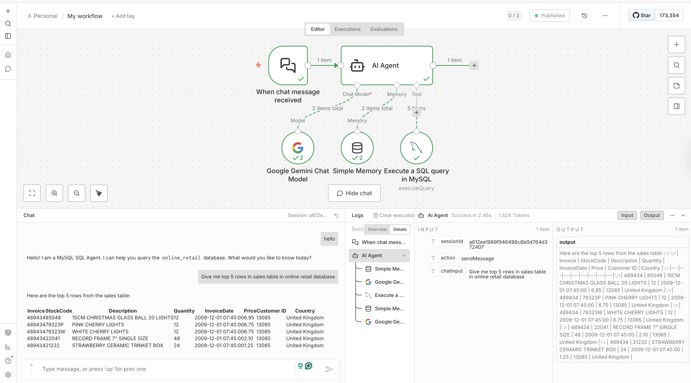

# MySQL Retail Analytics Agent (Gemini + Tool Calling)

A lightweight AI data agent that answers business questions over a **MySQL** database by **generating safe SELECT-only SQL**, executing it via a tool, and returning results with a plain-English summary.



This project uses:
- **Docker** to run MySQL reliably
- **MySQL Workbench** for database inspection and debugging
- **Gemini (Google) Chat Model** as the LLM
- A workflow builder (AI Agent node + MySQL query execution tool)

---

## What this agent does

- Connects to **MySQL** database: `online_retail`
- Queries table: `sales`
- Returns:
  1) The SQL query it executed   
  3) A brief plain-English explanation  

---

## Architecture (high level)

**User message → AI Agent (Gemini) → MySQL Execute Tool → Results → Explanation**

Agent nodes used in the workflow:
- Trigger: **When chat message received**
- Model: **Google Gemini Chat Model**
- Memory: (optional) **Simple Memory**
- Tool: **Execute a SQL query in MySQL**

---

## Dataset

**Database:** `online_retail`  
**Table:** `sales`

| Column | Meaning |
|------|---------|
| Invoice | Invoice number |
| StockCode | Product code |
| Description | Product name |
| Quantity | Units purchased |
| InvoiceDate | Timestamp |
| Price | Unit price |
| Customer ID | Customer identifier |
| Country | Country |

---

## A-to-Z Setup

### 1️⃣ Prerequisites
Install:
- **Docker Desktop**
- **MySQL Workbench**
- A workflow builder that supports:
  - Gemini chat model
  - Tool calling (MySQL query execution)

---

### 2️⃣ Start MySQL using Docker

Create a `docker-compose.yml`:

```yaml
version: "3.8"
services:
  mysql:
    image: mysql:8.0
    container_name: online-retail-mysql
    restart: unless-stopped
    environment:
      MYSQL_ROOT_PASSWORD: root_password
      MYSQL_DATABASE: online_retail
      MYSQL_USER: retail_user
      MYSQL_PASSWORD: retail_pass
    ports:
      - "3306:3306"
    volumes:
      - mysql_data:/var/lib/mysql

```

---

  ### 3️⃣ Connect with MySQL Workbench

Open **MySQL Workbench** → click **+ (New Connection)** and use:

- **Host:** `127.0.0.1`  
- **Port:** `3306`  
- **Username:** `retail_user` (or `root`)  
- **Password:** `retail_pass` (or `root_password`)  
- **Default Schema:** `online_retail`  

Click **Test Connection** → **Save**.

---

### 4️⃣ Create / Import the `sales` Table

**Option A (Recommended): Import CSV using Workbench**

- Go to **Workbench → Schema `online_retail` → Table Data Import Wizard**
- Select your dataset **CSV**
- Choose **Create new table**
- Set **Table name:** `sales`

**Map columns as:**

- `Invoice` → `VARCHAR`  
- `StockCode` → `VARCHAR`  
- `Description` → `TEXT`  
- `Quantity` → `INT`  
- `InvoiceDate` → `DATETIME`  
- `Price` → `DECIMAL`  
- `Customer ID` → `VARCHAR` or `INT`  
- `Country` → `VARCHAR`

---

### 5️⃣ Sanity Checks (run in Workbench)

```sql
SHOW TABLES;

SELECT COUNT(*) AS row_count FROM sales;

SELECT * FROM sales LIMIT 10;
```
---

### 6️⃣ Create the n8n Workflow

### Trigger
- **When chat message received**

### Nodes Used
- **AI Agent**
- **Google Gemini Chat Model**
- **Simple Memory** (optional)
- **Execute a SQL query in MySQL**

---

## 7️⃣ Configure Google Gemini

- Create **Gemini API credentials**
- Attach credentials to the **Google Gemini Chat Model**
- Test the agent with:
```text
hello
```
---

## 8️⃣ Configure MySQL Execute Tool

Add tool: **Execute a SQL query in MySQL**

### Configuration
- **Host:** `127.0.0.1`
- **Port:** `3306`
- **Database:** `online_retail`
- **Username:** `retail_user`
- **Password:** `retail_pass`

### Test
```sql
SELECT * FROM sales LIMIT 1;
```
---
## 9️⃣ Wire the Nodes (Important)

### Recommended Wiring
- Trigger → AI Agent
- AI Agent → MySQL Execute Tool
- MySQL Execute Tool → AI Agent


### Why this wiring matters
- The **AI Agent** decides when a database query is required  
- The **MySQL Execute Tool** runs the query safely  
- Results are returned to the **AI Agent** for summarization and explanation  

---

## 🔐 Agent System Prompt (Critical)

```text
You are LedgerMind, a governed AI data agent connected to a MySQL database.

Database: online_retail
Table: sales

Columns:
Invoice, StockCode, Description, Quantity, InvoiceDate, Price, Customer ID, Country

Rules:
- Only generate SELECT queries.
- Never use INSERT, UPDATE, DELETE, DROP, ALTER, TRUNCATE, CREATE.
- Revenue = Quantity * Price.
- Use backticks for columns with spaces (e.g., `Customer ID`).
- Default LIMIT 10 unless specified.
- Ask one clarification question if the request is ambiguous.

Output format:
SQL: <query>
Output: <rows>
Explanation: <1–3 sentences>
```


